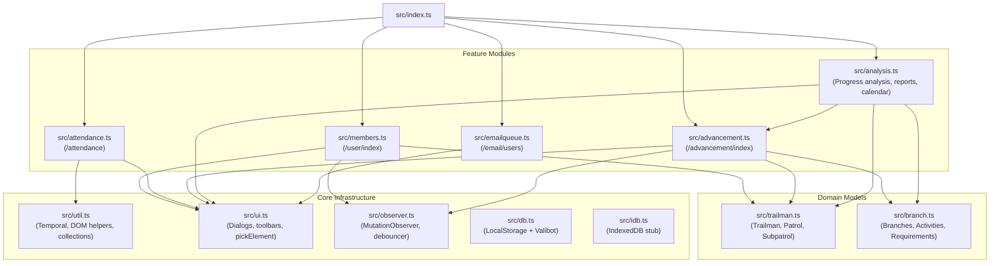

# AGENTS.md — Developer & AI Agent Guidelines for `tlc`

> **Essential guidance, architecture map, bug catalog, and operational rules for AI agents and human contributors working on `tlc`.**

---

## 1. Executive Summary & Context

`tlc` is a browser extension ([Tampermonkey](https://www.tampermonkey.net/) userscript) that injects power tools into [Trail Life Connect (TLC)](https://www.traillifeconnect.com/), the web portal for Trail Life USA troops. It focuses on the **Woodlands Trail** elementary program (Foxes, Hawks, Mountain Lions), automating attendance imports, batch advancement entry, gap analysis, and report generation.

### Heritage & Code Quality Notes
- **Mix of Hand-Crafted & Early AI Code**: This repository contains a blend of carefully thought-out domain logic (e.g. Woodlands Trail advancement algorithms, July 15 cutoff date math, HTT reallocation rules) and early **Gemini 2.5-generated code** (e.g. IndexedDB boilerplates, copy-pasted message queues, and unfinished refactorings).
- **Cruft & Technical Debt**: There are uncalled functions, suppressed unused-variable warnings (`const [] = [...]`), dead skeletons, and a few latent runtime bugs.
- **Current Source of Truth**: The **`main`** branch (commit [`70a3e95`](file:///l:/home/sdh/src/tlc/src/advancement.ts)) is the primary, working branch that builds cleanly with `npm run build`.

---

## 2. Branch Landscape: `main` vs. `idb` and Jujutsu (`.jj`)

When navigating this repository, you will observe multiple Git branches and Jujutsu (`.jj`) commits:

```
[idb / 837cf52] Work on setting up IndexedDB (Broken exports, broken idb.ts)
   │
   ├─ [mvzyrpzx / c5dad4c] Save full ConcreteActivity history
   ├─ [rouznynz / c08a6fa] Remove replacer support in db
   ├─ [vqpuwvoy / 9260c08] Switch PlainDate parse/stringify to use String()
   │
[main / 70a3e95] Add a "Matching Only" option for "Uncheck All" (Working build!)
```

### Why `main` is Preferred Over `idb`
1. **The `idb` Branch is Broken & Incomplete**:
   - Moved `scrapeBranch` and `getBranchData` from [src/branch.ts](file:///l:/home/sdh/src/tlc/src/branch.ts) into [src/advancement.ts](file:///l:/home/sdh/src/tlc/src/advancement.ts), but left [src/analysis.ts](file:///l:/home/sdh/src/tlc/src/analysis.ts) importing them from `./branch`, causing `esbuild` to immediately fail.
   - Copied a raw message-store implementation generated by Gemini into [src/idb.ts](file:///l:/home/sdh/src/tlc/src/idb.ts) with undeclared types (`IMessage`) and missing properties (`this.dbName`).
   - Left incomplete Valibot schema mappings (`branch` property missing in `scrapeBranch` return object).
2. **The `main` Branch Builds**:
   - `main` compiles cleanly with `npm run build` to emit `dist/tlc.js` (186 KB).
   - In `main`, [src/idb.ts](file:///l:/home/sdh/src/tlc/src/idb.ts) is just a clean 32-line stub.
   - **Guideline**: All new work, bug fixes, and documentation should target or branch from **`main`**. Do not attempt to merge `idb` without addressing its compile and runtime regressions.

---

## 3. Trail Life USA Domain Knowledge

To work safely on advancement and attendance logic, you **must** understand the domain rules:

### Patrols & Woodlands Trail Levels
- **Foxes**: Kindergarten & 1st Grade (approx. age 5–6)
- **Hawks**: 2nd & 3rd Grade (approx. age 7–8)
- **Mountain Lions (ML)**: 4th & 5th Grade (approx. age 9–10)
- Every patrol has a 2-year cycle: **Year 1** and **Year 2**.
- Subpatrols are named `Fox 1`, `Fox 2`, `Hawk 1`, `Hawk 2`, `Mountain Lion 1`, `Mountain Lion 2`.

### The July 15 Program Year Cutoff
- Trail Life operates on a program year starting in the summer.
- The boundary date is **July 15** (implemented in [src/util.ts](file:///l:/home/sdh/src/tlc/src/util.ts#L70-L73) via `july15`).
- Any completion date *before* the most recent July 15 is considered "Last Year" (`isLastYear()`).
- Any completion date *on or after* July 15 is "This Year" (`isThisYear()`).
- This boundary controls whether a boy is working towards their Year 1 Branch Pin or their Year 2 Sylvan Star, and determines whether an activity counts toward the current program year.

### The 7 Branches
1. Heritage (`HERITAGE`)
2. Life Skills (`LIFE`)
3. Science & Technology (`SCIENCE`)
4. Hobbies (`HOBBIES`)
5. Values (`VALUES`)
6. Sports & Fitness (`SPORTS`)
7. Outdoor Skills (`OUTDOOR`)

### Activity Types & Substitutions
- **`core`** (Core Steps): Mandatory curriculum topics.
- **`elective`** (Electives): Discretionary branch activities.
- **`htt`** (Hit The Trail): Outdoor hikes, field trips, campouts.
- **`home`** (Family Home Activities): At-home assignments that can substitute for missed steps or HTTs:
  - 2 completed family home activities substitute for 1 missed step or HTT (`report.home >>> 1` in [src/analysis.ts](file:///l:/home/sdh/src/tlc/src/analysis.ts#L856)).
  - Generally capped at one substitution per program year (`homeFree` flag).
- **Extra HTT Credit Transfer (`🔀`)**:
  - A boy only needs 1 HTT per branch per year (1 for Branch Pin, 2 total for Sylvan Star).
  - Any surplus HTTs earned in a branch (recorded with `EXTRA:` in completion comments) can be transferred to fulfill a missing HTT in a different branch.
  - [src/analysis.ts](file:///l:/home/sdh/src/tlc/src/analysis.ts#L711-L735) implements a priority greedy allocator (`byPriority`) to direct extra HTT credits to branches closest to earning an award.

### Awards
- **Branch Pin (`🪾` existing / `🌿` newly earned)**: Requires completing required Core Steps, Electives, and HTT for Year 1.
- **Sylvan Star (`⭐` existing / `🌟` newly earned)**: Requires completing 2x the requirements (Year 1 + Year 2).
- **Forest Award (`🌲`)**: Earned when all 7 branches achieve their Branch Pin (Year 1) or Sylvan Star (Year 2).

---

## 4. Architectural Map & Module Directory

The userscript entry point is [src/index.ts](file:///l:/home/sdh/src/tlc/src/index.ts), which imports five feature modules:



### Module Responsibilities

1. **[src/trailman.ts](file:///l:/home/sdh/src/tlc/src/trailman.ts)**
   - Schema for `Trailman` (names, TLC ID, patrol, year, subpatrol).
   - Wraps `localStorage` key `__sdh__trailmen`.
   - Populates in-memory maps (`byId`, `byName`, `byPatrol`, `byYear`, `bySubpatrol`) on update.
2. **[src/branch.ts](file:///l:/home/sdh/src/tlc/src/branch.ts)** (on `main`)
   - Schema for `Branch`, `Activity`, `BranchData`, `ConcreteActivity`.
   - Exports `selectedBranchName()`, `scrapeBranch()`, and `getBranchData()`.
   - Manages `localStorage` key `__sdh__all_branch_data`.
3. **[src/members.ts](file:///l:/home/sdh/src/tlc/src/members.ts)**
   - Operates on `/user/index` (Troop Members).
   - Scrapes `tr.user_grid` to harvest TLC member IDs (`dataset.key`), names, birthdates, and assigned patrols.
   - Calculates Year 1 vs Year 2 using birthdates relative to `july15` / `oct31`.
4. **[src/attendance.ts](file:///l:/home/sdh/src/tlc/src/attendance.ts)**
   - Operates on `/attendance`.
   - Implements CSV parser (`papaparse`), drag-and-drop handler, and paste listener.
   - Fuzzy-matches roster names using `fuzzball` and stores manual mappings in `__sdh__attendance_corrections`.
   - Toggles checkmarks on the attendance grid.
5. **[src/advancement.ts](file:///l:/home/sdh/src/tlc/src/advancement.ts)**
   - Operates on `/advancement/index` (Grid View).
   - Injects quick-select buttons for patrol years (`Fox 1`, `Fox 2`, etc.).
   - Provides DOM interaction: `pickEventDetails()`, `splitDates()` (green/red styling based on `isLastYear`), `filterByRow()`, `filterOutByRow()`.
   - Batch check / uncheck functionality.
6. **[src/analysis.ts](file:///l:/home/sdh/src/tlc/src/analysis.ts)**
   - Deep advancement calculation engine:
     - `CompletedActivities`: Parses concrete completions, tracks core steps, electives, HTTs, and family home activities.
     - `BranchProgress` / `ProgressBar`: Visual progress bar formatting and award eligibility computation.
     - `analyzeProgress()`: Iterates through all 7 branches, reallocates extra HTTs, generates printable HTML report with emoji key.
     - `exportAttendance()`: TSV matrix export.
     - `editCalendar()`: Modal calendar editor for scheduled events.
7. **[src/emailqueue.ts](file:///l:/home/sdh/src/tlc/src/emailqueue.ts)**
   - Operates on `/email/users`.
   - Working IndexedDB database `MessageDB` with store `messages`.
   - Provides a `SendNext` button that reads a message from IndexedDB, populates TLC form fields, and submits.
8. **[src/ui.ts](file:///l:/home/sdh/src/tlc/src/ui.ts)**
   - UI primitive layer built on HTML5 `<dialog>`.
   - Modal helpers: `Dialog.info()`, `Dialog.confirm()`, `Dialog.textarea()`, `Dialog.html()`, `Dialog.editableTextarea()`.
   - Toolbar builders: `addButtonsToTop()`, `addButtonsAfter()`, `dom()`, and `pickElement()`.
9. **[src/observer.ts](file:///l:/home/sdh/src/tlc/src/observer.ts)**
   - MutationObserver watching `document.body` with a 2-second debounce timer (`Temporal.Duration.from({seconds: 2})`).
   - Dispatches document change callbacks registered via `addDocumentChangeListener(pathname, handler)`.
10. **[src/util.ts](file:///l:/home/sdh/src/tlc/src/util.ts)**
    - Date parsing: `parseDate(s)` supports `mm/dd/yy`, `mm/dd/yyyy`, `yyyy-mm-dd` and returns `Temporal.PlainDate`.
    - Temporal utilities: `today`, `july15`, `isBefore`, `isLastYear`, `isThisYear`, `toSlash`.
    - Helper data structures: `DefaultMap`, `Multiset`.
    - DOM / browser helpers: `downloadData`, `waitFor`, `queryAll`.
11. **[src/db.ts](file:///l:/home/sdh/src/tlc/src/db.ts)**
    - Type-safe `localStorage` wrapper parameterized by Valibot schema.
    - Features a microtask-based `fresh` flag to minimize JSON parse overhead within the same event turn.

---

## 5. Catalog of Cruft, Technical Debt & Recently Fixed Bugs

When working on this codebase, be aware of the following known areas and recent bugfixes:

### Recently Fixed Issues (Commit `main`)
1. **Undeclared Identifier `origText` in `uncheckAll()` ([src/advancement.ts](file:///l:/home/sdh/src/tlc/src/advancement.ts#L213-L220))**:
   - Fixed by deriving `origText` from `$('textarea#comment-specified').val()?.trim() || ''`.
   - Also fixed `${label}` string interpolation to `${label.textContent}` in the confirmation dialog prompt.
2. **Map Key Bug in [src/trailman.ts](file:///l:/home/sdh/src/tlc/src/trailman.ts#L37)**:
   - Fixed `byName` mapping from `[t.id, t]` to `[t.name, t]`, allowing `getTrailmanByName()` to function correctly.
3. **Double-Click & Misspelled Flag in [src/attendance.ts](file:///l:/home/sdh/src/tlc/src/attendance.ts)**:
   - Removed premature `$(button).click()` on match, ensuring checkboxes are only clicked once in the final pass.
   - Fixed typo `'INGORE'` -> `'IGNORE'`.
   - Added `new Set(buttons)` deduplication and robust check state detection before toggling.

### Ongoing Technical Debt & Caveats

1. **CalDb One-Way Transform Serialization Caveat**:
   - **File**: [src/analysis.ts](file:///l:/home/sdh/src/tlc/src/analysis.ts#L46-L56)
   - **Problem**: `const Date = v.pipe(v.string(), v.transform(parseDate));` parses a string into a `Temporal.PlainDate`. When written back to `localStorage`, `calDb.set()` serializes the PlainDate object to JSON, but reading it back expects string input in the Valibot schema if not properly handled. Keep an eye on calendar read/write fidelity.

2. **Dead / Abandoned Code Skeletons**:
   - **`src/advancement.ts` line 385**:
     ```ts
     function updateMemoizedProgress() {
       if (1 < 2) return; // TODO - this is a mess!
     ```
     This function was an early attempt to memoize grid advancement progress into `advancementsDb`. It is deactivated and contains suppressed unused warnings.
   - **`src/idb.ts`**:
     A 32-line stub on `main`. Do not import or wire up without implementing a robust IndexedDB provider.

---

## 6. Development & Build Workflow

### Environment
- **Node.js**: v20+ / v22+ (recommended via NVM).
- **Shell**: WSL (Ubuntu) or Git Bash on Windows. The npm build script relies on bash process substitution (`cat <(sed ...) <(esbuild ...)`).

### Shell Commands (from workspace root)

```bash
# 1. Install dependencies
npm install

# 2. Build production userscript (dist/tlc.js)
npm run build

# 3. Typecheck codebase with TypeScript compiler
npx tsc --noEmit

# 4. Watch for changes during development
npm run watch
```

### In-Browser Verification
1. Install Tampermonkey in your browser.
2. In Tampermonkey options, add a userscript pointing to the local file using [userscript.local.js](file:///l:/home/sdh/src/tlc/userscript.local.js):
   ```javascript
   // ==UserScript==
   // @name         Trail Life Connect Tools (local)
   // @match        https://www.traillifeconnect.com/*
   // @grant        none
   // @require      file:///path/to/tlc/dist/tlc.js
   // ==/UserScript==
   ```
3. Whenever you run `npm run build`, simply refresh the Trail Life Connect page.

---

## 7. Guidelines for AI Coding Agents

When prompt engineering, refactoring, or generating code in this repository:

1. **Work from `main`**: Always ensure your branch or edits align with `main`. Do not revive the discarded `idb` branch without explicitly discussing it with the user.
2. **Preserve Legacy DOM Selectors**:
   - Trail Life Connect is built on legacy PHP (Yii framework) with jQuery.
   - Selectors like `.user_grid`, `#trailmen-select`, `#badge-select`, `.advance-icon[data-value="1"]`, `.cbx-container input`, and `#emailusersform-*` are exact reflections of TLC's DOM. Do not "clean up" or replace these selectors unless TLC's page markup changes.
3. **Handle `Temporal` Correctly**:
   - The project uses modern ECMAScript `Temporal` APIs (`Temporal.PlainDate`, `Temporal.Now.plainDateISO()`).
   - If writing Node-compatible tests or running in environments without native `Temporal`, be mindful that native global `Temporal` is expected by default in `tsconfig.json`.
4. **Maintain Valibot Schemas**:
   - Data validation uses `valibot` (v1.2.0).
   - Use `v.pipe()`, `v.object()`, and `v.InferOutput<typeof Schema>` for schemas.
5. **Preserve Comments & Domain Explanations**:
   - Per behavioral guidelines, preserve existing docstrings and comments explaining Trail Life advancement policies, award logic, and workarounds.

---

## 8. Recommended Roadmap for Future Enhancements

Future enhancements should tackle items in this priority order:

1. **[Refactoring] Clean up dead advancement memoization**:
   Either implement proper advancement caching or delete the disabled `updateMemoizedProgress()` and unused `advancementsDb`.
2. **[Architecture] Proper IndexedDB Migration**:
   If migrating off `localStorage`, design an asynchronous repository pattern that doesn't break synchronous data access across UI rendering loops.
3. **[Testing & Polyfill] Headless Testing**:
   Decouple DOM and node environments (or use a modern jsdom/browser test runner) to add unit tests for date math (`parseDate`, `july15`) and advancement calculations (`CompletedActivities`, `BranchProgress`).
